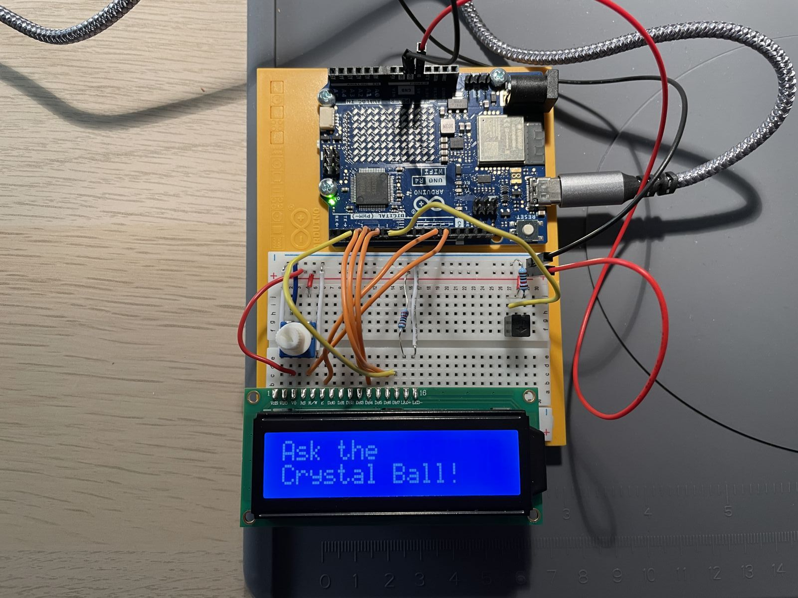

# Project 10: Crystal Ball

Tilting the board makes a 16x2 LCD show one of eight random answers, like a Magic 8 Ball.

https://github.com/user-attachments/assets/77eafea8-c099-4946-96bc-fea489a7654e

<!-- Video: Inbox/_para-subir/project10_CrystalBall.mp4 -->

## Circuit

| Component | Pin |
|---|---|
| LCD RS | D12 |
| LCD E | D11 |
| LCD D4–D7 | D5, D4, D3, D2 |
| Tilt switch | D6 |
| LCD contrast (V0) | Potentiometer |
