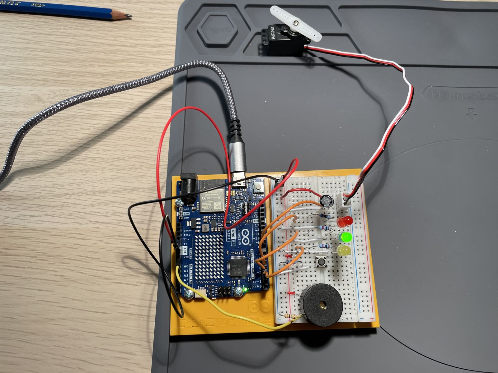

# Project 11: Knock Lock

A push button locks a servo latch; three knocks of the right strength on a piezo unlock it again.

https://github.com/user-attachments/assets/80760163-45bd-4f5a-b09b-ea7a82b4dfee

## Circuit

| Component | Pin |
|---|---|
| Piezo (knock sensor) | A0 |
| Push button (lock) | D2 |
| Yellow LED (valid knock) | D3 |
| Green LED (unlocked) | D4 |
| Red LED (locked) | D5 |
| Servo | D9 |

## Notes

- A knock counts as valid when the piezo reading is between 20 and 100.
- A single knock was counted more than once, so the sketch waits 500 ms after each valid knock before reading again.
