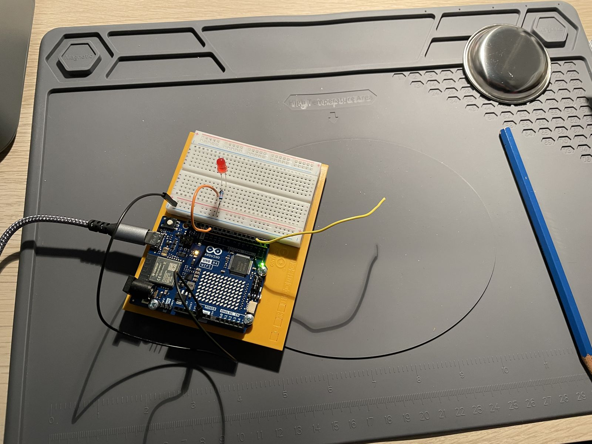

# Project 12: Touchy-Feely Lamp

Touching a metal bowl wired to the board turns an LED on; letting go turns it off.

_Video pending._

## Circuit

| Component | Pin |
|---|---|
| Touch sensor (metal bowl) | D2 |
| Red LED | D12 |

## Notes

- Uses the UNO R4's built-in capacitive touch (`Arduino_CapacitiveTouch` library); a reading over 4000 counts as a touch.
