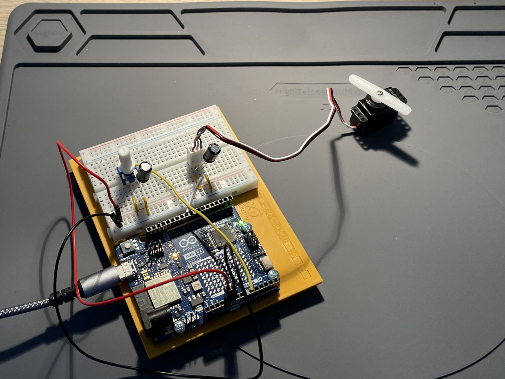

# Project 5: Mood Cue

A potentiometer sets the angle of a servo motor (0–179°).

<!-- Video: edit this file on github.com and drag the clip (under 10 MB) here; GitHub turns it into an inline player. -->
_Video pending._

## Circuit

| Component | Pin |
|---|---|
| Potentiometer | A0 |
| Servo motor (signal) | D9 (PWM) |

## Notes

- The UNO R4 has a 12-bit ADC. With `analogReadResolution(12)` readings go from 0 to 4095 instead of 0 to 1023, which
  gives finer control of the servo.
