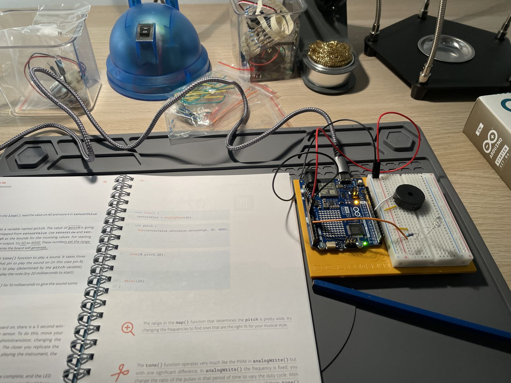

# Project 6: Light Theremin

A phototransistor sets the pitch of a piezo buzzer: more light, higher note.

_Video pending._

## Circuit

| Component | Pin |
|---|---|
| Phototransistor | A0 |
| Piezo buzzer | D8 |
| Built-in LED (calibration) | D13 |

## Notes

- For the first 5 seconds the LED stays on while the sketch records the lowest and highest light readings. Pitch is
  then mapped from that range to 50–4000 Hz.
- 12-bit ADC (`analogReadResolution(12)`), so `sensorLow` starts at 4095 instead of 1023.
