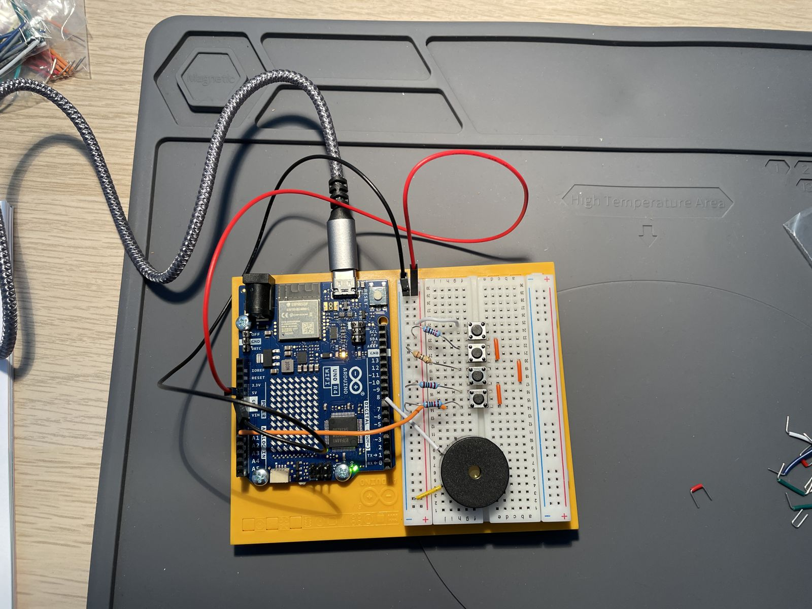

# Project 7: Keyboard Instrument

Four push buttons on a resistor ladder play C, D, E and F on a piezo buzzer, all read from a single analog pin.

_Video pending._

## Circuit

| Component | Pin |
|---|---|
| Buttons (resistor ladder) | A0 |
| Piezo buzzer | D8 |

Each button reads a different value on A0:

| Button | A0 reading | Note |
|---|---|---|
| 1 | > 1020 | C4 (262 Hz) |
| 2 | 950–1010 | D4 (294 Hz) |
| 3 | 490–515 | E4 (330 Hz) |
| 4 | 15–25 | F4 (349 Hz) |

## Notes

- The ranges were measured on this board by printing `analogRead(A0)` to the Serial Monitor while pressing each
  button, so they may need adjusting with other resistors.
