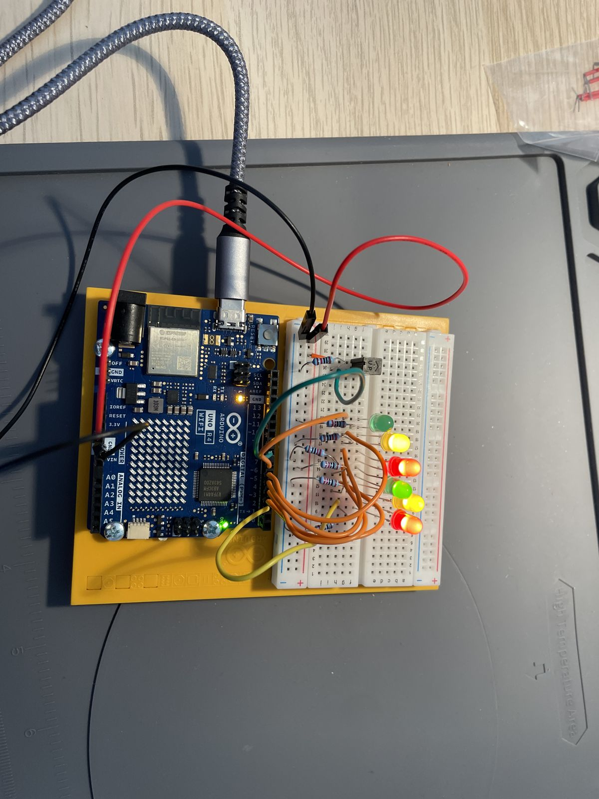

# Project 8: Digital Hourglass

Six LEDs light up one by one, one per second, using `millis()`; flipping the tilt switch turns them off and restarts
the count.

<!-- Video: edit this file on github.com and drag the clip (under 10 MB) here; GitHub turns it into an inline player. -->

https://github.com/user-attachments/assets/c4f4479f-4e65-49d9-92d3-19a3f6dd2cc2

## Circuit

| Component | Pin |
|---|---|
| LEDs 1–6 | D2–D7 |
| Tilt switch | D8 |
