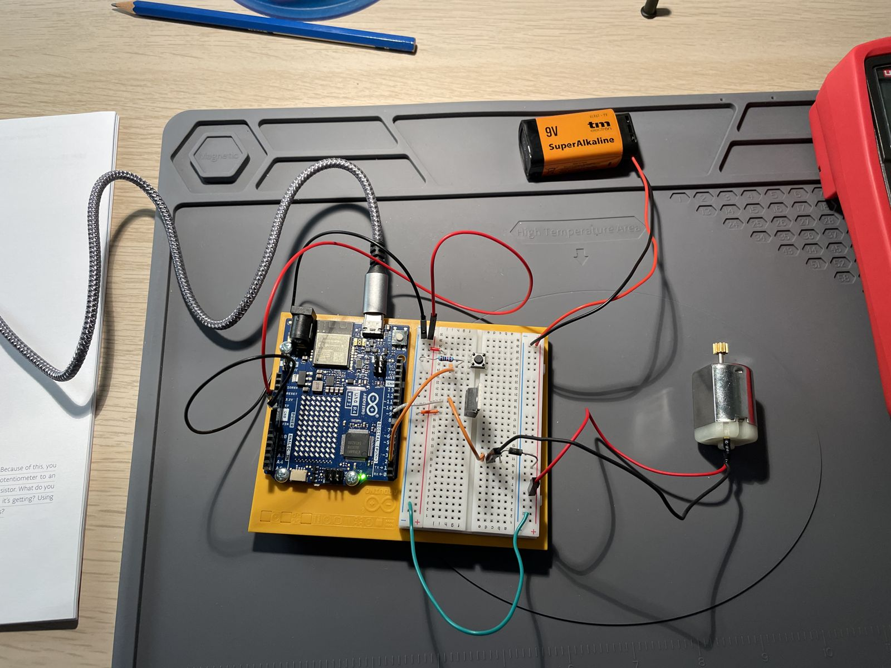

# Project 9: Motorized Pinwheel

A push button switches a DC motor on through a transistor; the motor runs from a separate 9 V battery.

<!-- Video: edit this file on github.com and drag the clip (under 10 MB) here; GitHub turns it into an inline player. -->

https://github.com/user-attachments/assets/18212695-a124-4df4-a14f-754ad262e584

## Circuit

| Component | Pin |
|---|---|
| Push button | D2 |
| Transistor gate (motor) | D9 |
| Motor supply | 9 V battery |
